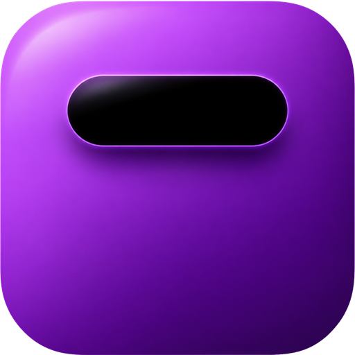
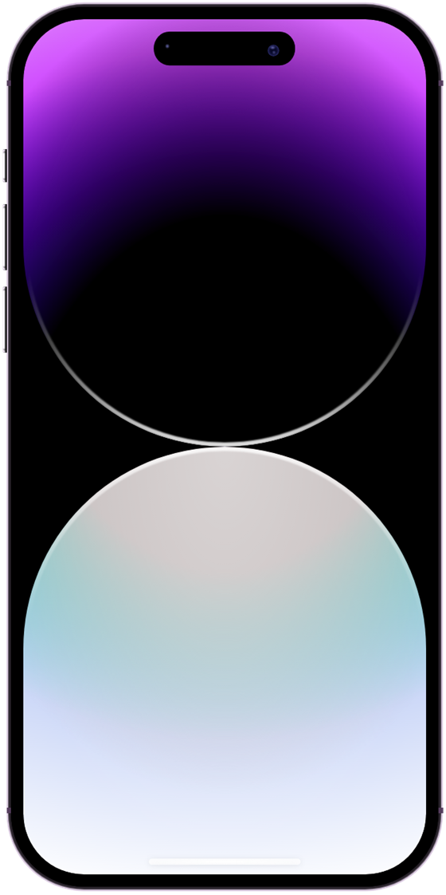
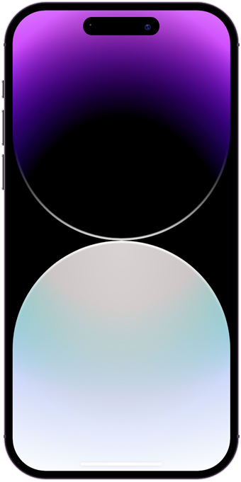
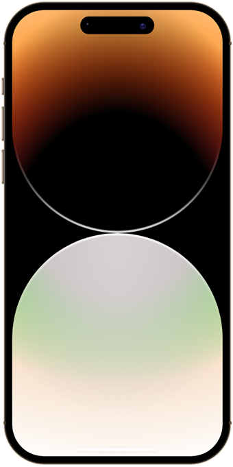
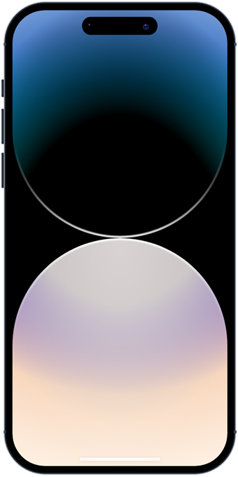
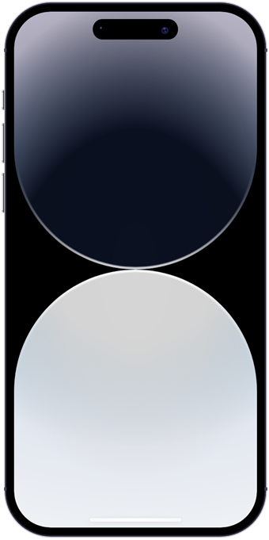

<p align="center">
  
</p>

<h1 align="center">Dynamic Island</h1>

<p align="center">
  <b>Интерактивная «Dynamic Island» в стиле iPhone на чистых HTML и CSS, без единой строки JavaScript.</b>
</p>

<p align="center">
  
  
  
  <a href="https://dekciw.github.io/DynamicIslandCSS/"></a>
</p>

<p align="center">
  <a href="https://dekciw.github.io/DynamicIslandCSS/">
    
  </a>
</p>

<br>

<table align="center">
  <tr>
    <td width="50%" valign="top">
      
    </td>
    <td width="50%" valign="top">
      <h3>Что умеет</h3>
      <ul>
        <li><b>Раскрывается при наведении</b>: «чёлка» плавно растягивается и показывает заголовок, подпись и прогресс-бар, как у плеера</li>
        <li><b>Работает с клавиатуры</b>: остров получает фокус по Tab и раскрывается так же, как от мыши</li>
        <li><b>4 темы</b>: Deep Purple, Gold, Space Black и Silver. Меняются цвет корпуса, кнопок и обои</li>
        <li><b>Анимация появления</b>: телефон и кнопки тем плавно возникают при загрузке</li>
        <li><b>Масштабируется под окно</b>: все размеры заданы в <code>em</code> от <code>1vmin</code></li>
      </ul>
      <h3>Как попробовать</h3>
      <p>Открой <a href="https://dekciw.github.io/DynamicIslandCSS/">живое демо</a>, наведи курсор на «чёлку» и переключи тему кружками сверху.</p>
    </td>
  </tr>
</table>

<h3 align="center">Темы</h3>

<table align="center">
  <tr>
    <td align="center"><br><sub>Deep Purple</sub></td>
    <td align="center"><br><sub>Gold</sub></td>
    <td align="center"><br><sub>Space Black</sub></td>
    <td align="center"><br><sub>Silver</sub></td>
  </tr>
</table>

<br>

<details>
<summary><b>Подробнее о проекте: как это устроено, запуск, структура</b> (нажми, чтобы развернуть)</summary>

<br>

## Содержание

- [Как это работает без JavaScript](#как-это-работает-без-javascript)
- [Запуск](#запуск)
- [Как поменять текст в острове](#как-поменять-текст-в-острове)
- [Структура проекта](#структура-проекта)

## Как это работает без JavaScript

**Переключение тем.** В начале разметки стоят четыре скрытых `<input type="radio" name="theme">`, а кружки сверху являются `<label for="...">` к ним. Клик по кружку выбирает радиокнопку, и правила вида

```css
#theme-gold:checked ~ .dynamic-island__device { ... }
```

через соседний селектор `~` перекрашивают корпус, кнопки и включают нужный слой обоев.

**Раскрытие острова.** У `.device__island` стоит `tabindex="0"`, поэтому на нём срабатывают и `:hover`, и `:focus-within`. По этим состояниям увеличивается `max-height`, появляются текст и прогресс-бар, а кривая `cubic-bezier(0.666, 0, 0.4, 1.2)` даёт лёгкий «отскок» в конце анимации.

**Текст и время.** Заголовок, подпись и время `20:01` / `-8:28` выводятся через `content` в псевдоэлементах, отдельных узлов с текстом в разметке нет.

**Обои и свечение.** Фон экрана собран из градиентов и картинки `background-img.png` с режимами наложения и размытием. Для каждой темы свой слой, видимым становится только слой выбранной темы.

## Запуск

Сборка и зависимости не нужны. Достаточно открыть `index.html` в браузере:

```bash
git clone https://github.com/dekciw/DynamicIslandCSS.git
cd DynamicIslandCSS
# открой index.html двойным кликом или через любой локальный сервер
```

Шрифт Inter подгружается из Google Fonts. Без интернета страница отобразится системным шрифтом.

## Как поменять текст в острове

Текст задан в `style.css` в свойствах `content`. Найди в файле строки `https://github.com/dekciw`, `20:01` и `-8:28` и замени их на свои значения.

## Структура проекта

```
.
├── index.html           # разметка: радиокнопки тем, корпус телефона, экран и остров
├── style.css            # темы, анимации, раскрытие острова
├── background-img.png   # текстура обоев экрана
└── assets/              # логотип и скриншоты для README
```

</details>

<!-- Pull Shark 1 -->

<!-- Pull Shark 2 -->
